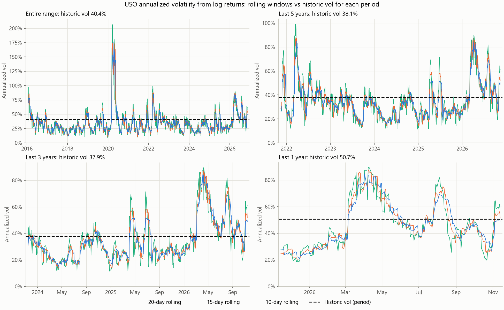
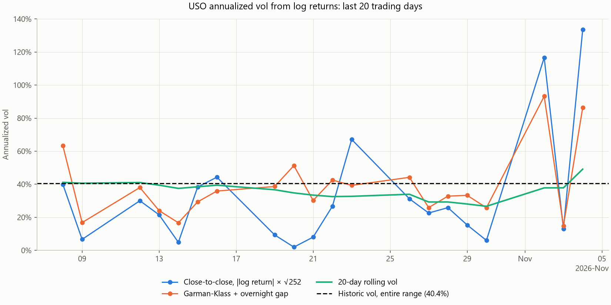

# Volatility Forecast: Team Catch-Up

*Last updated November 5, 2026, using price data through November 4. This is a snapshot of where things stand. Everything under next steps and roles is a suggestion, so please change whatever doesn't fit.*

## The short version

- **The goal:** give the tool a ticker and a horizon (10 to 20 trading days), and it returns a *distribution* of future realized volatility (RV). The main signal is where implied volatility (IV) sits inside that distribution: near the top suggests options look rich, and near the bottom suggests they look cheap.
- **Where we are:** USO data is ready, the first GARCH model has been fit, and we have charts comparing the main ways of measuring vol. Nothing has been backtested yet, so no forecast has been shown to work.
- **What we've learned:** USO returns have very fat tails and strong volatility clustering, so GARCH with Student's t innovations on log returns is the right starting point. The year 2020 has a large effect on many of these statistics.
- **What needs attention first:** the daily options download has not saved any data yet (see below).
- **What's next:** fix the download, agree on conventions, then build a walk-forward test that scores GARCH against simple baselines.

## ⚠️ Urgent: the daily options download isn't saving data

Alpaca has no historical option quotes, so every missed day is lost for good.

| Run | Log output | Data saved |
|---|---|---|
| Nov 3, 6:00pm | Start line only | None |
| Nov 3, 9:00pm | Start line only | None |
| Nov 4, 6:40pm | Start line only | None |
| Nov 4, 11:41pm | Start line only | None |

- `data/options/` still contains only its README, so the Nov 3 and Nov 4 snapshots for all 10 tickers weren't saved.
- Windows reported the last run's result as `0xC000013A`, which means the process was stopped as if by Ctrl+C or a closed console window. **We haven't confirmed the cause.**
- The next run is scheduled for Nov 5 at 6:00pm ET.

**Suggested fix:** after 4:15pm ET, run `run_daily_download.bat` by hand and watch whether files appear. Output may be getting lost when the process is stopped, so adding `-u` to the `python.exe` line in that file would show how far it gets. Check `data/options/` the next day, not only the log.

**What we do have for USO:** the working copy of `options_data/USO_option_chain.csv` holds Nov 4's chain, and Git history holds the Nov 3 mid-morning chain. `data_download.py` overwrites that file on each run, so commit it to keep Nov 4.

## Contents

1. [Where things stand](#where-things-stand)
2. [What's in the repo](#whats-in-the-repo)
3. [Setup](#setup)
4. [Things to know before using the data](#things-to-know-before-using-the-data)
5. [Volatility concepts](#volatility-concepts)
6. [What we've learned so far](#what-weve-learned-so-far)
7. [How to test forecasts](#how-to-test-forecasts)
8. [Where IV fits](#where-iv-fits)
9. [Suggested next steps](#suggested-next-steps)
10. [Things to think about](#things-to-think-about)
11. [If we split the work three ways](#if-we-split-the-work-three-ways)
12. [If you want to re-download data](#if-you-want-to-re-download-data)

## Where things stand

| Area | Status | Notes |
|---|---|---|
| USO price history | Done | 2,726 trading days (2,725 returns), 2016-01-04 to 2026-11-04 |
| USO option chain | One snapshot | 6,102 contracts, from Nov 4's trading session |
| Daily options download, all 10 tickers | **Not working** | Task runs, but no data saved yet. See above |
| Return distribution analysis | Done for USO | Normal vs Student's t, on simple and log returns |
| Volatility charts | Done for USO | Rolling vs historic vol, and daily vol measures |
| Python environment | Done | `requirements.txt` added, and `arch` tested on Python 3.14 |
| First GARCH fit | First pass done | GARCH(1,1) normal and t on all of USO's history. No diagnostics or backtest yet |
| Target definition and conventions | Not started | **Suggested next step after the download fix** |
| Baselines and walk-forward testing | Not started | Method is outlined below |
| Other models (GJR, HAR, GARCH-X, HMM) | Not started | |
| IV history | Not started | See [The IV history problem](#the-iv-history-problem) |
| Seasonality and event analysis | Not started | |

The club's tickers are WEAT, CORN, SOYB, USO, BNO, UGA, UNG, IAU, SLV and CPER. We're starting with USO because it has the most liquid options of those we compared, with a near-the-money bid/ask spread of about 7%, versus 15% for UNG and 22% for UGA.

## What's in the repo

| Path | What it is |
|---|---|
| `etf_data/USO_daily_prices.csv` | Daily USO prices. **Start here for modeling** |
| `options_data/USO_option_chain.csv` | The single current USO chain snapshot |
| `data/options/` | Where daily snapshots for all tickers will build up, with a column guide in its README |
| `requirements.txt` | Packages for the analysis and GARCH models |
| `distributions.py` | Return distribution charts, and normal vs Student's t fits |
| `historic_vol.py` | Rolling vol, historic vol and Garman-Klass charts |
| `GARCHFORMULA` | Notes on the GARCH formula (one correction is listed under cleanups) |
| `data_download.py` | Re-downloads the two USO CSVs above and **overwrites them** |
| `download_options.py`, `run_daily_download.bat` | The daily snapshot downloader and the script that launches it |
| `plots/` | Charts from `distributions.py` and `historic_vol.py` |

### The charts

| File | What it shows | Why it matters |
|---|---|---|
| `returns_over_time.png` | Daily log and simple returns | Calm and wild periods cluster, which is what GARCH models |
| `returns_histograms.png` | Number of days in each 0.5% return bin | Returns center near 0, with a sharp peak and a few extreme days |
| `returns_vs_normal.png` | Histograms vs a normal curve | Higher peak, thinner shoulders and much fatter tails than a normal |
| `normal_vs_t.png` | Simple returns: normal vs t | Student's t fits far better |
| `normal_vs_t_log.png` | Log returns: normal vs t | Same conclusion on the return type we plan to use |
| `rolling_vol_log.png` | 20, 15 and 10-day rolling vol vs historic vol, over four date ranges | Shows how window length and sample period change the answer |
| `rolling_vol_simple.png` | The same, from simple returns | Almost identical apart from extreme days |
| `recent_vol_measures.png` | Last 20 days: close-to-close, Garman-Klass + gap, rolling and historic vol | Shows how noisy single-day measures are |

The tails on the log-scale charts are easy to misread. One day in a bin has a density of about 0.07, so isolated tail bars all sit at that height. A curve can look like it misses them even when the fit is reasonable.

## Setup

You don't need an Alpaca account to work with the committed CSVs. From the project folder, on Python 3.14:

**Windows**

```powershell
python -m venv venv
.\venv\Scripts\python.exe -m pip install -r requirements.txt
.\venv\Scripts\python.exe historic_vol.py
```

**Mac or Linux**

```bash
python3 -m venv venv
./venv/bin/python -m pip install -r requirements.txt
./venv/bin/python historic_vol.py
```

The Windows install has been tested in a clean environment, including a GARCH fit. Mac and Linux haven't been tested, and other Python versions may need different package versions.

Both scripts redraw their charts, so your plots will show as changed in Git if the data has changed. To load the data directly:

```python
import pandas as pd

prices = pd.read_csv("etf_data/USO_daily_prices.csv", parse_dates=["Date"], index_col="Date")
returns = prices["Log_Returns"].dropna()
```

## Things to know before using the data

**Prices**

- Use `Closing_Price` and `Log_Returns` for volatility. They're adjusted for USO's 1-for-8 reverse split on 2020-04-29.
- `Raw_Closing_Price` has a false jump at that split. Only use it to compare against strikes from the time, since old option strikes were quoted in unadjusted prices.
- The prices come from Alpaca's SIP feed, which covers all US exchanges. The `coins_data` function `get_price_bars_df` uses IEX, one exchange at about 1% of USO's volume, with history only from mid-2020. It would miss the 2020 crash and return raw prices with the split in them.
- Other tickers need the same split check. UNG, for example, had 1-for-4 reverse splits on 2018-01-05 and 2024-01-24.
- The high, low, open and close passed basic consistency checks on every row (the high and low contain the open and close, with no blanks). We haven't confirmed whether the highs and lows include pre-market and after-hours trading.

**Options**

- `options_data/USO_option_chain.csv` was refreshed before the Nov 5 open, so its quotes are from Nov 4's session. Quote times range from 9:30am to about 4:00pm ET, so some are stale. Check `quote_time`, as `snapshot_time` is only the latest quote in the file.
- `underlying_price` in that file is taken when the script runs, not when each quote was made. Here it's 145.37, against a Nov 4 close of 145.41.
- In that snapshot, 22.0% of contracts have no IV or Greeks, and 23.8% have no open interest. Filter before using them.
- Check `bar_date` before trusting volume, because a thin contract's latest bar can be from an earlier day.
- Quote timestamps are current, but trades on Alpaca's `indicative` feed are delayed about 15 minutes.
- USO options are American-style. We haven't checked how Alpaca calculates its IV, so it's worth confirming before relying on those numbers.

**Daily snapshots**

- The scheduled task runs on one person's laptop on weekdays at 6pm and 9pm ET, so the laptop has to be on and logged in by then or soon after.
- **A missed day can't be recovered**, because Alpaca has no historical option quotes.
- Snapshots stay on that laptop until someone commits them.

## Volatility concepts

This section is the shared vocabulary for the rest of the project. If you're comfortable with it, you can skip to [What we've learned so far](#what-weve-learned-so-far).

### Annualized vol

Annualized vol restates volatility as a one-year figure, so numbers from different time spans share one scale. Take the standard deviation of daily returns, then multiply by the square root of the trading days in a year:

`annualized vol = daily vol × √252 = 2.55% × 15.87 ≈ 40.4%`

The square root appears because variance adds up across independent days, and vol is the square root of variance. You can scale back down the same way:

| Horizon | Calculation | Typical move at 40% vol |
|---|---|---|
| 1 day | 40% × √(1/252) | ±2.5% |
| 10 days | 40% × √(10/252) | ±8.0% |
| 20 days | 40% × √(20/252) | ±11.3% |
| 1 year | 40% | ±40% |

**Annualized vol is a unit, not a prediction.** A 10-day rolling vol of 64% doesn't mean USO moved 64%, or that the next year will have 64% vol. It means the last 10 days were volatile enough that a full year at that pace would be 64%. The √252 rule also assumes independent days, and we know vol clusters.

### Every vol number has a window

Annualizing standardizes the units, but not the window. To compare two vol numbers fairly, they need to cover windows of the same length. To test a forecast, they also need to cover the same dates.

| | Window | Looks | Comes from | Length is set by |
|---|---|---|---|---|
| **Rolling vol** | Last N days | Backward | Actual returns | Choosing N |
| **Implied vol** | Today until option expiry | Forward | Option prices | Choosing the maturity (and it also varies by strike) |
| **GARCH forecast** | Next H days | Forward | Past returns and the fitted model | Choosing H |
| **Realized vol** | The H days after the forecast date | Backward, once they've passed | Actual returns | Matching H |

**Our decision horizon sets the window, and everything else matches it.** For a 20-day decision on date t:

| Quantity | What to use |
|---|---|
| GARCH forecast | Average forecast variance over t+1 to t+20, annualized |
| Implied vol | At-the-money, about 20 trading days (about 28 calendar days) to expiry, interpolated between expiries |
| Realized vol (what we score against) | 20-day vol measured over t+1 to t+20 |
| Naive baseline | 20-day rolling vol over t-19 to t |

Each comparison answers a different question:

- **GARCH vs. today's rolling vol:** what does the model expect to change?
- **GARCH vs. future realized vol:** was the forecast accurate?
- **Today's rolling vol vs. future realized vol:** how good is simply assuming the last 20 days repeat? GARCH has to beat this to be worth using.
- **GARCH vs. implied vol:** this is the potential trading signal, comparing our forecast with the market's over the same window.

### What a GARCH number means

GARCH's basic output is the expected variance for **one day**. A multi-day forecast comes from running the formula forward, with each day drifting toward the long-run level:

`σ²(t+h) = V_L + (α+β)^(h-1) × (σ²(t+1) − V_L)`

Here, V_L is long-run variance, and α+β is persistence: how slowly a vol shock fades. To get a forecast for a whole window, **average the daily variances over the window, then annualize and take the square root.** Average variance rather than vol, because variance is what adds up across days.

So a single model on a single day gives many valid numbers. See the [first GARCH fit](#first-garch-fit) for USO's. That curve is GARCH's version of IV's different values across maturities. A GARCH number only means something once it has a window attached, such as "next 20 trading days, annualized".

### Where GARCH gets its starting vol

We never feed GARCH a measured current vol, because true vol can't be observed. It calculates its own estimate by applying one equation, day by day, across all our history:

`σ²(t+1) = ω + α × ε²(t) + β × σ²(t)`

ε²(t) is the observed squared return after removing the mean, and σ²(t) is the model's previous estimate. Today's vol is simply the last step of that chain.

The chain needs a value for the very first day, so software uses a rough estimate from the early returns. That choice barely matters, because its influence shrinks by a factor of β each day. Here it is on USO, using illustrative parameters (α = 0.08, β = 0.89, long-run vol = 40%):

| Days into the data | Start at 10% | Start at 40% | Start at 200% |
|---|---|---|---|
| 0 | 10.0% | 40.0% | 200.0% |
| 20 | 66.3% | 67.4% | 91.0% |
| 60 | 38.6% | 38.6% | 39.0% |
| 100 | 30.9% | 30.9% | 30.9% |
| Forecast for Nov 5, 2026 | 56.6% | 56.6% | 56.6% |

The parameters are estimated at the same time, by maximum likelihood: try different values of ω, α and β, run the whole chain each time, and keep the set that makes the actual returns most likely.

So a GARCH number isn't a measurement of true vol. It's the vol implied by this model, these parameters and these past returns. The uncertainty comes from the parameter estimates and from the equation only approximating how vol behaves, and the backtest is how we check whether the number is any use.

### True vol vs. what we can measure

A day's true vol can't be observed. GARCH treats each return as `r = σ × z`, where σ is the day's vol and z is random luck, and we only see the result. It's like a weighted coin: you can see every flip, but not the true probability of heads.

The close-to-close return is the real **return**, but it's only a noisy estimate of the day's **vol**. Even if true vol were exactly 40%, |r| × √252 would land between about 5% and 66% on 80% of days under a normal distribution. So a large miss on one day doesn't necessarily mean a forecast was wrong.

## What we've learned so far

### Student's t beats normal for USO returns

From `distributions.py`. Excess kurtosis is a measure of tail fatness, where a normal scores 0.

| Log returns (our planned basis) | Actual data | Normal | Student's t (df = 3.67) |
|---|---|---|---|
| Excess kurtosis | 16.27 | 0 | Infinite (df is 4 or less) |
| Days beyond ±10% | 17 | 0.2 expected | 14.6 expected |
| AIC (lower is better) | | -12,265 | -12,923 |

| Simple returns | Actual data | Normal | Student's t (df = 3.74) |
|---|---|---|---|
| Excess kurtosis | 11.59 | 0 | Infinite (df is 4 or less) |
| Days beyond ±10% | 16 | 0.2 expected | 14.1 expected |
| AIC (lower is better) | | -12,343 | -12,928 |

- **This fit ignores volatility clustering.** Mixing calm and wild periods creates some fat tails on its own, which is why GARCH's t fit below has a higher df of 6.72.
- **We should use log returns from here on.** They add up across days, which suits a multi-day horizon. The same data shows higher kurtosis on log returns because the log transform stretches large losses.
- **The worst days should stay in the data unless testing shows otherwise.** Those were -29.2% on 2020-03-09 and -28.7% on 2020-04-21 in log terms (-25.3% and -24.9% simple). They're real events the model has to cope with.

### Evidence for GARCH and its setup

These checks use log returns.

| Check | Result | Implication |
|---|---|---|
| Average daily return vs daily vol | 0.02% vs 2.55% | A constant or zero mean should be enough |
| Autocorrelation of returns (lag 1) | 0.05 | Little need for an AR term in the mean |
| Autocorrelation of absolute returns (lags 1, 5, 10, 20) | 0.30, 0.26, 0.23, 0.14 | Slow decay means vol shocks last, which matters for 10 to 20 day forecasts |
| Days beyond ±10% in March and April 2020 | 11 of 17 | The t gets the count about right, but only GARCH can address the timing |
| Annualized vol by year | 25% (2017) to 73% (2020), and 54% so far in 2026 | Vol changes a lot over time, so a constant-vol assumption fails |

### 2020 has a large effect

| Log returns | All data | Without 2020 |
|---|---|---|
| Annualized vol | 40.4% | 35.3% |
| Excess kurtosis | 16.27 | 2.77 |
| Skew | -1.37 | -0.25 |
| Correlation of yesterday's return with today's squared return | -0.13 | 0.00 |

- **Fat tails:** most of the measured kurtosis comes from one year, though returns still have fat tails without it.
- **Asymmetry:** vol rising after price drops looks like a 2020 effect, not a general one. GJR or EGARCH may add little, and skewed t may not be needed either. Test them anyway, keeping them only if they improve out-of-sample results.
- **Long-run level:** the 5-year and 3-year samples exclude 2020 but still have vol near 38%, because they include high-vol stretches in 2022 and 2026. So a lower level isn't guaranteed by dropping 2020.

### Rolling vol and historic vol

From `historic_vol.py`, annualized and calculated separately for each period:

| Period | Starts | Trading days | Historic vol (log) | Historic vol (simple) |
|---|---|---|---|---|
| Entire range | 2016-01-05 | 2,725 | 40.4% | 39.9% |
| Last 5 years | 2021-11-05 | 1,254 | 38.1% | 38.0% |
| Last 3 years | 2023-11-06 | 752 | 38.0% | 38.0% |
| Last 1 year | 2025-11-05 | 251 | 50.6% | 50.8% |



- **The past year is unusual:** at 50.6% vol, it's well above the longer samples, so the fitting window will affect where forecasts revert to.
- **Spikes dominate:** rolling vol seems to spend most of its time below the historic line, with short spikes above it. That fits the right-skewed vol distribution the README describes, and suggests historic vol overstates a typical day.
- **Window size matters:** after the Nov 4 drop, 10-day vol reads 64.1%, 15-day 55.0% and 20-day 49.1%. The window we pick as a target will change how forecasts score.
- **Log vs simple:** vol levels barely differ, apart from extreme days (the 2020 peak is about 205% on log and 195% on simple).

### Measuring a single day's vol

A day's high and low show how far the price actually traveled, so they carry more information about that day's vol than two closing prices.

**Parkinson** uses the high and low:

`σ²_P = [ln(H/L)]² / (4 ln 2)`

**Garman-Klass** also uses the open and close:

`σ²_GK = ½[ln(H/L)]² − (2 ln 2 − 1)[ln(C/O)]²`

Both only see the session from open to close, assuming random price movement with no drift or jumps. GARCH on close-to-close returns covers the full 24 hours, and **the overnight gap makes up about 55% of USO's close-to-close variance**, likely because oil keeps trading while the ETF is closed. So we add it back:

`σ²_daily = σ²_GK + [ln(O(t) / C(t-1))]²`

| Annualized | Full sample | Nov 3, 2026 | Nov 4, 2026 |
|---|---|---|---|
| Close-to-close (\|r\| × √252 for single days) | 40.4% | 13.1% | 133.5% |
| Parkinson | 28.4% | 12.2% | 73.9% |
| Garman-Klass | 29.2% | 13.6% | 70.1% |
| **Garman-Klass + gap** | **41.7%** | **14.8%** | **86.4%** |

**An example of why this matters:** on 2022-11-21, USO's close was unchanged at 69.03. It opened at 66.67 and traded between 65.37 and 69.37, yet close-to-close scores that day as 0% vol, against 79% for Garman-Klass + gap. There are 27 unchanged-close days in the data, averaging about 27% vol on Garman-Klass + gap.

| | Close-to-close (r²) | Garman-Klass + gap |
|---|---|---|
| **Matches what GARCH models** | Yes, exactly | Approximately |
| **Bias** | None, if the mean is about right | Variance runs about 6.5% high on USO |
| **Noise** | Very high | Much lower (lag-1 autocorrelation of daily vol is 0.50, vs 0.30 for \|r\|) |
| **Assumptions** | Very few | Random price movement with no drift or intraday jumps |

Neither one is the true vol. Close-to-close is unbiased but noisy, and Garman-Klass + gap is sharper but slightly biased.



This chart shows the difference over the last 20 trading days. Close-to-close ranged from 2% to 134%, and Garman-Klass + gap from 15% to 93%, while 20-day rolling vol moved slowly. The last rolling value is built directly from the close-to-close points, and Nov 2 and Nov 4 alone make up about 69% of it, so a couple of days can dominate a 20-day average.

### First GARCH fit

GARCH(1,1) on log returns, fit to all of USO's history (returns × 100). **This is in-sample and hasn't been backtested or checked for residual problems, so these aren't validated forecasts.**

| | GARCH-normal | GARCH-t |
|---|---|---|
| α | 0.125 | 0.093 |
| β | 0.843 | 0.880 |
| Persistence (α+β) | 0.968 | 0.973 |
| Half-life of a vol shock, ln(0.5) / ln(α+β) | 21 trading days | 26 trading days |
| Student's t degrees of freedom | n/a | 6.72 |
| Long-run vol | 39.7% | 37.4% |
| AIC (lower is better) | 11,922 | 11,779 |

The two models' forecasts as of Nov 4, annualized:

| Window | GARCH-normal | GARCH-t |
|---|---|---|
| Next 1 day | 64.8% | 59.0% |
| Next 10 days | 62.1% | 57.0% |
| Next 20 days | 59.4% | 55.1% |

- **The t's df rose from 3.67 to 6.72 once clustering was modeled**, confirming that part of the fat tails came from vol clustering.
- **GARCH improves on a constant-vol t.** On the same scale, AIC falls by about 396, from about 12,175 to 11,779. (These AICs aren't directly comparable with the earlier table, because the returns are scaled by 100.)
- **The distribution changes the forecasts here.** After two large recent moves, normal is about 6 points higher for tomorrow and 4 points higher over 20 days. A normal reacts more to large returns, so don't assume the distribution only affects tails.
- **Forecasts fall with the horizon** because vol is above its long-run level and is expected to drift back toward it.
- **Half-life matters for a 20-day forecast:** at 26 days, the current level still carries a lot of weight across the whole window.

### How GARCH is likely to fit in

- Fit GARCH to **daily returns**, not a rolling vol series. Overlapping windows are autocorrelated and break the likelihood.
- If using `arch`, multiply returns by 100 to help the optimizer converge, and divide variance forecasts by 100² afterward.
- A reasonable starting setup is a 3 to 5 year window (750 to 1,250 days), refit weekly or monthly. It's worth also testing an expanding window, since a 3 to 5 year window drops 2020 entirely.
- Fit with and without 2020, and compare α+β, df and long-run vol. The suggested default is to keep it for tail risk, unless that comparison shows it distorts the fit.

## How to test forecasts

### Testing over a horizon (the main test)

Our output is about a whole period, so this test comes first. For each horizon H (10 or 20 days), and for every date t in the test period:

1. **Fit:** fit GARCH using only returns through day t. To save time, re-estimate weekly or monthly and update the variance daily.
2. **Forecast:** get the daily variance forecasts for t+1 through t+H.
3. **Combine:** average those variances, annualize, then take the square root.
4. **Wait:** let H trading days pass.
5. **Measure realized vol** over those same days, using our planned target: `RV(t,H) = sqrt( (252/H) × sum_{i=1..H} r²(t+i) )`
6. **Record the pair:** save the forecast and realized value, move to t+1, and repeat.

```python
from arch import arch_model
import numpy as np

# i is the position of day t; H is the horizon
fit = arch_model(100 * r.iloc[:i + 1], mean="Constant", vol="GARCH",
                 p=1, q=1, dist="t").fit(disp="off")

daily_var = fit.forecast(horizon=H).variance.iloc[-1] / 100**2
forecast_vol = np.sqrt(daily_var.mean() * 252)

future = r.iloc[i + 1 : i + 1 + H]   # must contain H days
realized_vol = np.sqrt((future ** 2).mean() * 252)
```

Then score the pairs:

- **Accuracy:** compute QLIKE on the variances, `ln(h) + RV²/h`, where h is forecast vol squared. Lower is better.
- **Baseline:** run the same score on the trailing H-day rolling vol from day t. GARCH has to beat it.
- **Bias:** check the average of forecast minus realized.
- **Distribution:** once we simulate paths, check coverage. Realized vol should land inside an 80% band about 80% of the time.

**The most common mistake is misaligned dates.** A rolling vol value stamped on a date describes the *past* N days, so the realized value for a forecast made on date t comes from 20 trading days *later*:

```python
realized_next_20 = rolling_20.shift(-20)
```

Without that shift, you're comparing a forecast with returns from before it was made. Note that `.rolling(20).std()` subtracts a window mean and divides by n-1, so it isn't quite the same as the planned target. Scoring should use the target formula.

### Testing the daily forecasts

GARCH produces day-by-day forecasts, so it's worth testing those too. Because no single measure of daily vol is perfect, **score against both close-to-close and Garman-Klass + gap**:

1. Each day t, use only data through day t to forecast variance for t+1.
2. Calculate r² and Garman-Klass + gap for t+1 once available.
3. Convert everything to the same units (decimal returns, if the model was fit on returns × 100).
4. Score across all days with QLIKE. Use r², not |r|, because |r| understates vol (it averages about 80% of σ under a normal).
5. Run the same score on a baseline, such as trailing 20-day variance.
6. Check bias by regressing the realized measure on the forecast. An intercept near 0 and a slope near 1 mean the forecasts are unbiased.

If GARCH beats the baseline on both measures, we can trust the result. If they disagree, the bias or the noise may be behind it, and that's worth investigating. Days with a zero return are fine in this QLIKE formula, but they'd break anything that takes the log of r².

Don't judge a daily forecast on single days. Nov 3 is a good example: after Nov 2's large drop, a daily GARCH forecast should jump, yet the two measures read only 13% and 15% that day. That's one calm draw during a volatile stretch, not necessarily a bad forecast.

### Why they still won't match

Even with aligned windows, the numbers will differ for real reasons:

- **Realized vol is noisy:** a 20-day sample is small, so even a perfect forecast misses on individual dates. Judge across many dates.
- **Overlap reduces real sample size:** neighboring 20-day windows share 19 days, so there's closer to one independent result per 20 days. Use Newey-West errors, and check non-overlapping windows too.
- **No lookahead:** nothing from after day t can go into the fit, including parameters or scaling.

## Where IV fits

Standard GARCH doesn't use IV. There are three ways to bring it in:

1. **As the signal:** compare the forecast to IV. IV usually sits above later realized vol, and that gap is called the variance risk premium.
2. **As an input:** add IV as an extra term in the variance equation (GARCH-X).
3. **As a benchmark:** a model that can't beat IV may not be adding much.

IV and GARCH won't match even over the same window:

- **IV isn't a pure forecast:** it usually includes a risk premium, so a gap between GARCH and IV isn't automatically a trade.
- **IV varies by strike:** that's why we need a fixed convention, such as at-the-money.
- **Day counts differ:** IV usually counts calendar time, while our vol numbers use 252 trading days.
- **Thin markets distort it:** USO is our most liquid option, and it still has wide spreads on some contracts.

**One snapshot, not a signal:** in Nov 4's chain, the near-the-money IV for the Dec 4 expiry (30 calendar days, about 21 trading days) was about 54.7%. That's the median across 50 contracts within 5% of the underlying price, with a positive bid. GARCH-t's in-sample 20-day forecast from the same date is 55.1%, and GARCH-normal's is 59.4%. Trailing 20-day vol was 49.1%, but that's a past window. It's a useful example of lining up the numbers, but one date proves nothing.

### The IV history problem

Testing an IV signal needs IV history, and we have little of it so far:

| Source | History | Cost | Catch |
|---|---|---|---|
| **OVX** (FRED: `OVXCLS`) | Back to 2007 | Free | Fixed at 30 days, and it reflects the whole smile, not just at-the-money options. We haven't pulled it yet |
| **Alpaca option bars** | From Jan 2024 | Free | Based on trades, not quotes. Only about 35 non-overlapping 20-day windows |
| **Our daily snapshots** | None yet | Free | Blocked until the download works, then takes a long time to build up |
| **OptionMetrics, ORATS, Cboe DataShop, Polygon, Databento** | Varies | Usually paid | Worth asking whether VT has OptionMetrics through WRDS |

OVX is computed from USO options, and 30 calendar days is about 21 trading days. That makes it a good match for our 20-day horizon but a weaker one for 10 days, since crude's volatility term structure can invert under stress. A 10-day comparison against OVX mixes model error with that mismatch.

One suggestion is to test in two tiers: price-based models on 2016 onward, and IV-based models on the shorter period where IV exists.

Our own constant-maturity IV would follow these steps:

1. Clean the chain.
2. Find at-the-money using the forward price.
3. Interpolate between expiries in **total variance** (σ²T), not IV:

   `σ²(T*) = [(T₂−T*)·σ₁²T₁ + (T*−T₁)·σ₂²T₂] / [(T₂−T₁)·T*]`

## Suggested next steps

Roughly in order, though steps 3 to 5 can run side by side:

1. **Fix the daily options download.** Every missed day is permanent, so this comes first. Consider a backup machine too.
2. **Write down our conventions and the target.** Add a short conventions doc and a `targets.py` with tests you can check by hand. The planned target, using log returns, is:

   `RV(t,h) = sqrt( (252/h) * sum_{i=1..h} r_{t+i}^2 )`

   We'd model its log at h = 10, 15 and 20. Doing this first means all of us score against the same number. See the decisions below.
3. **Build the baselines and a walk-forward test harness.** Baselines are trailing 10-day and 20-day vol, EWMA (λ = 0.94), HAR-RV and OVX. Everything runs through one harness, so results are comparable, covering both the horizon and daily tests.
4. **Finish checking GARCH-normal and GARCH-t on USO.** QQ-plot the standardized residuals, check that their squares show little remaining autocorrelation, and try skewed t only if they look skewed. Compare fits with and without 2020.
5. **Pull OVX from FRED** and do a first variance risk premium comparison.
6. **Produce the full distribution.** Simulate GARCH-t price paths, calculate each path's RV, and read off the percentiles. Compare that to the HAR regression route from the project plan.
7. **Then try the extensions:** GJR or EGARCH, GARCH-X with OVX or Garman-Klass inputs, HMM regimes, seasonality and events.
8. **Repeat for other tickers,** checking each for splits and fitting separately.

The full plan is several weeks of work. A version covering steps 1 to 4 plus a HAR model with IV would already be a defensible tool, so that makes a sensible first milestone.

### Decisions we should make together

| Decision | Suggested default | Why |
|---|---|---|
| Return type | Log returns | They add up across days, and match the planned target |
| Annualization | 252 trading days, and convert IV's calendar basis to match | Keeps every comparison on one basis |
| Horizons | 10, 15 and 20 trading days | From the project goal |
| Mean in realized vol | Zero | Simple, and the effect is tiny (about 0.1% of the vol level, using GARCH-t's fitted mean) |
| Distribution | Student's t | Clear fit improvement, and our output is a distribution |
| Fitting window | Test 3 to 5 years against expanding | Determines whether 2020 stays in |
| Handling 2020 | Keep unless testing shows otherwise | It may not be representative, but the risk it shows is real |
| IV convention | At-the-money, constant maturity, interpolated in total variance | Avoids strike and maturity differences |
| Daily scoring measure | Both r² and Garman-Klass + gap | They have opposite weaknesses |
| Forecast format | Date, horizon, percentiles | Lets everyone work in parallel |

### Small cleanups

- Fix `GARCHFORMULA`, which calls ω the "baseline vol ie historical vol". In fact, ω = long-run variance × (1 − α − β), which is much smaller than historical variance.
- Correct the line in `data/options/README.md` that calls quotes delayed. Only trades are.
- Consider adding `.idea/` and `.vscode/` to `.gitignore`.
- `historic_vol.py` and `distributions.py` hardcode their chart colors and only cover USO, so they'll need generalizing for other tickers.

## Things to think about

**Modeling**

- **How do we score a distribution?** QLIKE and Mincer-Zarnowitz regressions only judge point forecasts. Since the output is a distribution, we also need pinball loss, PIT histograms and interval coverage. A Kupiec VaR test checks daily return tails, which is useful but a different question.
- **Lookahead is the biggest risk.** Every input has to be something we'd actually have known on that date. Common traps are smoothed HMM probabilities, seasonal adjustments using full-sample averages, and scaling with full-sample statistics.
- **Overlapping targets inflate significance.** Daily 20-day forecasts share most of their data, so we need an embargo gap between training and test data, plus Newey-West standard errors. 2,725 days is far fewer independent observations than it sounds.
- **Is 2020 a different regime?** From memory, USO changed which futures it holds around April to May 2020, on top of the split. We haven't verified this, so it needs confirming before treating pre-2020 and post-2020 returns as the same process.
- **How much should the fitting window move the long-run level?** The range we've seen is about 35% (without 2020) to 51% (past year), and forecasts revert to whatever the model estimates.
- **Which realized vol window is the real target?** The 10-day and 20-day windows gave 64% and 49% on the same date. Trading decisions should drive this, not whichever scores best.
- **Do inventory reports need special handling?** Plain GARCH tends to underreact to jumps around EIA reports and OPEC meetings.
- **Should the log of vol be modeled directly?** The README suggests testing whether log vol looks closer to normal. We haven't charted this yet, and it applies to HAR-style regressions more than GARCH.
- **Is seasonality real for each commodity?** Not yet tested, and it needs to be checked by asset.

**Daily vol measures**

- **Does the overnight gap estimate hold up?** It's about 55% of variance, and depends on how the data defines the open. We should confirm which trading hours Alpaca's daily bars cover.
- **Are the high and low reliable on thinner ETFs?** A single odd print would inflate Garman-Klass on low-volume tickers, so USO's result may not carry over.
- **Could range data improve the forecasts themselves?** So far it's only for scoring, but it could also be a model input (GARCH-X, HEAVY or HAR).

**IV and thin markets**

- **A wide quote can look like a signal.** IV estimates on thin contracts can be distorted, so a "mispricing" may just be a wide spread. The tool should flag low-quality IV days and fall back to non-IV inputs.
- **One snapshot isn't evidence.** The Nov 3 mid-morning snapshot showed near-the-money IV of about 58% against trailing vol of about 38%, while Nov 4's showed about 55% against 49%. That gap moves a lot, and comparing with a past window isn't a test.
- **Timing has to match.** Comparing an option's price with an ETF price from a different time gives wrong IV. Some `coins_data` examples, such as `hist_iv.py` and `atm_iv.py`, mix an option's VWAP with the underlying's close, so be careful reusing them.

**Data and process**

- **How do we know the download worked?** The current failure left almost nothing in the log, so it was easy to miss. A simple check that new files exist, and an alert if they don't, would catch it.
- **Who backs up the download?** A second machine would protect against a laptop being off.
- **Where should daily snapshots live?** All 10 tickers come to about 3.4 MB a day, or roughly 860 MB a year uncompressed. Committing that to Git gets unwieldy, and the monthly files keep it under GitHub's 100 MB per-file limit but don't solve overall repo growth. Compression, Parquet or a shared drive are all options.
- **How do we handle shared data changes?** `data_download.py` overwrites the shared CSVs, so if each of us re-runs it, our results will drift apart. It's already happened once: adding two days changed every chart. We could agree on one person or a set schedule for refreshing the committed data.
- **What will other tools need?** Position sizing, limit pricing and the options parity strategy are all expected to use this tool, so it's worth keeping `vol_forecast(ticker, horizon)` and the evaluation harness reusable.

## If we split the work three ways

This is just one possible way to divide things, so that we each own something that moves the project forward. Please swap, combine or rewrite these based on what you're interested in or want to learn. Nobody is signed up for anything by this document, and it would make sense to talk it through as a group.

### Possible role: Data and IV

*Could be a good fit if you enjoy data pipelines and want to learn how options markets work.*

- **Fix the daily download first**, add a check that it worked, and set up a backup machine.
- Decide where snapshots are stored and who refreshes the shared data.
- Confirm which trading hours the daily bars cover, for the overnight gap.
- Pull OVX and look into OptionMetrics access.
- Build chain cleaning and the constant-maturity IV series.
- Work through split and data checks as we add tickers beyond USO.

### Possible role: Models

*Could be a good fit if you like statistics and want to go deep on volatility models.*

- Run residual checks on GARCH-normal and GARCH-t, building on the first fit.
- Test the effect of 2020 and the fitting window.
- Simulate paths to get the forecast distribution.
- Try HAR regressions, GJR or EGARCH, GARCH-X and later HMMs.
- Keep track of which models are worth continuing with.

### Possible role: Evaluation and tool

*Could be a good fit if you care about rigorous testing and building something others can use.*

- Write `targets.py` and its tests, including Garman-Klass + gap.
- Build the walk-forward harness, covering both horizon and daily tests, with scoring metrics and lookahead checks.
- Keep the baselines as the bar every model has to beat.
- Shape the final `vol_forecast(ticker, horizon)` output and its plots.

### Working across roles

Some things would probably work best together, whichever split we choose:

- **Conventions doc:** we should all agree on this, since all our work depends on it.
- **Handoffs:** Data supplies clean inputs, Models produces forecasts, and Evaluation scores them. Agreeing early on one simple forecast format (date, horizon, percentiles) would let everyone work in parallel.
- **Code review:** having someone from another role look over each other's work is a good way to catch lookahead bugs and for all of us to learn the whole project.

## If you want to re-download data

You only need this to refresh the CSVs. Everything else works from the committed files.

1. Follow [Setup](#setup), then install `requests` and `coins_data` from a local clone of `coins-data`:

   ```powershell
   .\venv\Scripts\python.exe -m pip install requests path\to\coins-data
   ```

2. Set the environment variables `ALPACA_API_KEY` and `ALPACA_SECRET_KEY`. The `coins-data` guide lists different names, but these are the ones the code reads. Keep your keys out of the repo.
3. Run `data_download.py` with the venv's Python, not your system one, and restart your terminal or app if it can't see newly saved keys.

Alpaca's free plan can't query the most recent 15 minutes of data. Also, `coins_data` installed this way doesn't update itself, so pull and reinstall to get changes.
